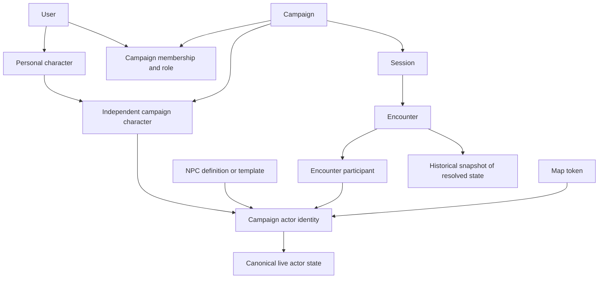

# Architecture: actual baseline and proposed system

Last inspected: 2026-11-19. No target application has been implemented.

## Actual repository

Before the knowledge-base task, the working tree contained a one-line `README.md` and the previously written `docs/PRODUCT_SPEC.md`. Only the README was in the initial remote commit. The knowledge-base task adds documentation and historical references, not an application.

```text
AGENTS.md
README.md
docs/
  PROJECT_CONTEXT.md
  ARCHITECTURE.md
  DECISIONS.md
  PROGRESS.md
  PRODUCT_SPEC.md
  references/
    README.md
    ORIGINAL_BRIEF_HE.md
    Adisdas_NPC_Codex.html
```

There are no package manifests/lockfiles, Angular workspace, application source directories, backend endpoints, migrations/schema, automated test suite, CI configuration, environment template, or deployment configuration. There is no valid target-app install/build/test command to run yet.

### Actual legacy reference architecture

[`references/Adisdas_NPC_Codex.html`](references/Adisdas_NPC_Codex.html) is a self-contained Hebrew RTL HTML file with inline CSS and vanilla JavaScript, not Angular source. Inspection found no external `src`/`href` resources. Its script parses the embedded `seed-data`, attempts to load browser storage, applies revisions, and renders one of three views: codex, players, combat.

- One mutable `state` object and UI state; event delegation and HTML string rendering.
- `localStorage` key `adisdas-npc-codex-v1`, `schemaVersion: 1`, `dataRevision: 4`.
- State arrays: locations, NPCs, players, encounters, saved encounters; plus current encounter ID.
- JSON backup export and whole-state replacement import with a basic structural check. The import handler limits the file to 5 MiB; this is legacy behavior, not the new product's decided limit.
- No server, account system, shared database, sessions, maps, real-time transport, PDF import, or dice roller.

| Legacy code anchor | Observed behavior / target implication |
| --- | --- |
| `applyDataRevision` | Revision-specific updates and player-HP normalization. Do not assume a fresh seed contains browser edits. |
| `validState` | Checks schema/array structure and some counts, not a complete domain validator. |
| `setPlayerHp`, `syncFighterHp` | Player sheet HP propagates to all encounter rows, even past encounters. Target needs canonical live state and immutable history. |
| `ensureEncounter`, `makeFighter` | New encounter automatically adds all players; NPC fighters get independent HP. Target requires selected participants and persistent world actor identities. |
| `turnEntries`, `next-turn` handler | Descending manual initiative, a shared entry per squad, round increment on wrap. Missing initiative sorts last. |
| `createSquad`, `disband-squad` handler | Template-derived independent fighters, shared initiative/target; disband leaves individual fighters. |
| `toggle-condition`, `toggle-dead` | Manual flags/tags. Death is not derived from zero HP. |
| `snapshot`, `load-snapshot` handler | Snapshot copies encounter; restoring creates another encounter and also changes canonical player HP. Viewing history in the target must never do this implicitly. |
| `exportJson`, file import handler | Entire legacy state backup/restore, not incremental bulk entity import. |

The reference can be opened as an HTML file for inspection. It writes browser-local state when run. This knowledge-base task inspected source and seed data; it did not perform browser UI testing or certify legacy behavior through execution.

## Proposed target architecture (not implemented)

**Selected:** Angular. **Proposed:** standalone components, feature-scoped NgRx SignalStore, NestJS API, PostgreSQL, private file storage, shared typed contracts, and framework-independent domain functions. These build on the original brief and subsequent planning. No package versions or provider have been pinned. Prisma was one original candidate, not a final ORM decision; SQLite was an early local-use option and is not the current recommendation for the multi-device product.

```text
apps/web/             Angular shell, routes, feature UI and stores
apps/api/             Identity/membership enforcement, commands, persistence, live delivery
packages/contracts/  Validated request/response/import contracts
packages/domain/     Pure domain operations and invariants where useful
docs/                Maintained knowledge base
fixtures/            Future migration/test fixtures; not created yet
```

The existing legacy HTML belongs under references, not in the application's public assets. Raw campaign references must not be bundled automatically for public users.

### Feature boundaries

- Identity/access: accounts, ownership, membership, join requests, invitations, display access.
- Campaigns: profile, visibility, settings, roster.
- Characters: personal library, campaign copies, PDF attachment/manual entry.
- World: nested locations, named NPCs, reusable definitions, documents/assets.
- Sessions: lifecycle, numbering, notes, live-operation policy.
- Combat: participants, initiative, rounds, squads, history.
- Presentation/maps: map scenes, token placement, visibility and authorized player display.
- Data management: import preview/commit, migrations, backups, exports.

Suggested routes are rooted at `/campaigns/:campaignId/` for campaign-owned features, with separate personal-library and player-display routes. Final URLs are not selected. Suggested stores are Campaign, World/Locations, NPCs, Characters/Players, Session/Encounter, Presentation, and local UI state. Cross-feature views reference shared canonical entities rather than synchronizing independent HP copies.

### Proposed data ownership



This is conceptual ownership, not an implemented schema or finalized cardinality diagram. The `CampaignActor` abstraction is proposed; named NPCs and campaign-character copies share the need for stable identity. A map token or encounter row references that identity instead of owning live HP. Some decorative tokens may have no actor. Snapshot data deliberately copies resolved values for history.

Other proposed entities: `Location(parentId)`, `Asset`, `Document`, `Map`, `Squad`, `PresentationState`, `ActivityEvent`, and `SessionNote`. Separate base/definition fields from live state and decide field ownership before writing migrations. An existing named NPC persists across encounters; spawning a reusable template creates separate identities.

### Commands and real-time flow

Proposed mutation flow:

1. A client submits a typed command with a unique operation ID; absolute edits also supply an expected version.
2. Server checks authenticated membership, ownership/role, session state, and input validity.
3. Domain logic calculates the change; a transaction writes state and its attributed activity event.
4. After commit, server publishes only the authorized representation to each audience.
5. Clients update the shared local representation. Reconnection reloads current authorized state rather than assuming no events were missed.

Damage/healing are relative atomic operations to avoid lost updates; explicit set-value operations detect stale versions. Retried commands must not apply twice. The precise deduplication store, event delivery mechanism, transport, and recovery protocol are still open. The activity log requirement does not imply an event-sourced database architecture.

Connection status and persistence feedback are visible. The proposed first release blocks mutations offline rather than attempting an unapproved merge policy. Undo/correction is an attributed new action, with conflict-aware handling if other actions intervened.

### Session and history boundaries

Proposed lifecycle: planned → active → paused → active → ended, also allowing active → ended. One open active/paused session per campaign is a proposed initial constraint, not a confirmed rule. Pause mutation locks and content editing while paused remain unresolved.

Encounter lifecycle and presentation selection are independent of the session lifecycle. DM selects encounter participants. Session/encounter start/end never implicitly resets actor HP, conditions, or resources. Historical viewing reads frozen state; any explicit restore needs its own authorization, preview, and current-state effects.

### Authorization boundaries

Campaign visibility, membership admission, and permission to individual fields/files are separate. Public discovery is not access to DM notes, full PDFs, hidden tokens, or the full player sheet. Re-check read and mutation access in HTTP handlers, file download delivery, subscriptions, and revocation of active connections. A player display must receive a filtered payload, not secrets hidden in the DOM.

The TV client needs narrow, revocable display authorization. Whether that uses pairing, a scoped token, or an authenticated display account is undecided. No local credential/SSH configuration is part of this design or repository.

### Imports and PDFs

The proposed bulk JSON envelope has `format`, `schemaVersion`, `sourceId`, and entity-specific arrays with `externalId`. Resolve identity within the destination campaign and source, never by name alone. Separate add-only and explicit update modes; missing fields preserve existing data, while explicit clearing semantics need a schema decision. Validate and map references, preview changes, then revalidate and save atomically. Detect state changes after preview. Full-backup restore is a different workflow.

Legacy import must preserve narrative strings, nulls, source IDs/mappings, and draft facts. A recent exported backup is preferable to embedded seed data when available. No importer is implemented.

PDF upload plus manual input is required. Extraction is proposed assistance only and must be reviewed by the user. No actual sample PDFs or extraction library have been selected; do not treat extraction as a solved capability.

## Validation plan once code exists

First prove one DM and one player can edit the same campaign character, see the changes on both clients, reconnect, and end/resume play without lost state. Include unauthorized/cross-campaign access, two simultaneous updates, repeated operation IDs, and unknown HP. Then extend to NPC instances, combat history, import replays, and TV projection while the DM switches views.

Document actual commands here when tooling is selected. The knowledge-base checkpoint only validates documentation, reference integrity, and repository state; it is not evidence of passing application tests.
