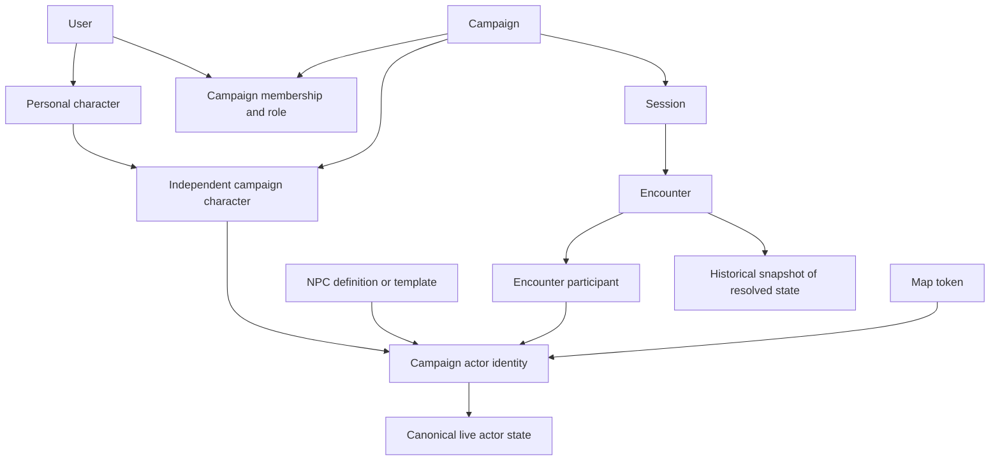

# Architecture: repository baseline and pilot design

Last inspected: 2026-11-20, during T02a (identity). Sign-in and profiles are implemented; no campaign features yet.

## Actual repository

T01 added the Angular workspace, the Supabase project files, the first migration and CI. The tree outside `node_modules/`:

```text
AGENTS.md, README.md          Agent instructions and entry point
.env.example                  Template for .env.local (git-ignored)
.nvmrc, .npmrc                Node 24; exact version pinning
package.json, package-lock.json
angular.json, tsconfig*.json  Angular 22.3.0 workspace (strict, SCSS, Vitest)
scripts/write-supabase-config.mjs
                              Generates src/app/core/supabase.config.generated.ts
                              (git-ignored) from env vars or .env.local
src/
  index.html                  lang="he" dir="rtl"
  styles.scss                 Dark theme tokens
  app/                        Shell (header with sign-in/out), Home, auth/callback route,
                              core/supabase.ts (supabase-js client, PKCE),
                              core/auth.ts (session + profile signals),
                              testing/fake-supabase.ts (unit-test stand-in)
supabase/
  config.toml                 Local/CI stack configuration
  migrations/                 baseline privileges, rls_auto_enable lock, profiles
  tests/database/             pgTAP guard tests
.github/workflows/ci.yml      Web build + unit tests; Postgres + pgTAP
docs/                         Knowledge base and references
```

Pinned toolchain at T01: Angular 22.3.0, TypeScript 6.0.3, Vitest 5.1.1, `@supabase/supabase-js` 2.119.2, Supabase CLI 3.2.0 (npm dev dependency), Node 24.15.0 / npm 11.12.1 on the Linux host.

### Commands

| Command | What it does |
| --- | --- |
| `npm ci` | Clean install from the lockfile. |
| `npm start` | Generates the Supabase config, then `ng serve` on http://localhost:4200. |
| `npm run build` | Generates the config, then a production build in `dist/`. |
| `npm test` | Generates the config, then the unit tests once (Vitest). |
| `npx supabase start -x …` / `npm run db:test` | Local Postgres + pgTAP. Requires Docker, which is optional on developer machines (A19); CI runs these. |
| `npx supabase db push --remote` | Applies new migrations to the linked hosted project. Supabase CLI 3 targets the local stack unless `--remote` is given. Run only after the migration is merged to `dev`; never edit an applied migration, add a new one. |
| `npm run test:realtime` | Live private-channel test with two users. Needs a running local stack and the env from `supabase status -o env`; refuses non-local URLs. Runs in CI. |
| `npx supabase test db --remote` | pgTAP against the linked hosted project. Still needs Docker or Podman: the CLI runs `pg_prove` in a container. Requires `supabase login` and `supabase link`. |
| `npx supabase db query --remote --read-only -f <file>` | Runs a read-only SQL file against the linked hosted project. No Docker and no database password; uses the `supabase login` session. Results are JSON. |
| [`supabase/checks/baseline_privileges.sql`](../supabase/checks/baseline_privileges.sql) | Docker-free, read-only check of the baseline on a hosted project. Paste into the dashboard SQL Editor; expected values are in the file. |

`npm start`, `build` and `test` fail on purpose when `SUPABASE_URL` or `SUPABASE_PUBLISHABLE_KEY` is missing, or when the key looks like a secret key.

### Database baseline (implemented)

The first migration removes implicit privileges for the browser roles: no default table or sequence grants to `anon`/`authenticated` in `public`, no global `EXECUTE` for `PUBLIC` on new functions, and an unexposed `app_private` schema for policy helpers. pgTAP guard tests fail CI if any table in `public` lacks RLS, if `anon` can execute any function in `public`, or if a newly created table/function receives implicit grants. No application tables exist yet.

**Identity (T02a, implemented):** `public.profiles (id → auth.users, display_name, created_at)` with RLS; `authenticated` may `SELECT` its own row only and has no direct writes. A trigger on `auth.users` calls `app_private.handle_new_user()` (`SECURITY DEFINER`, empty `search_path`) to create the profile from Google's `full_name`/`name` or the email prefix; the email is not stored. Only `supabase_auth_admin` may execute it. The web app signs in with `signInWithOAuth({ provider: 'google' })` using PKCE and returns to `/auth/callback`. Google provider setup is in [SETUP_GOOGLE_SIGNIN.md](SETUP_GOOGLE_SIGNIN.md). **Realtime authorization (T02b, implemented as a spike):** RLS policy `user_channel_receive_own` on `realtime.messages` lets an authenticated user join and receive only the private topic `user:<own uid>`; there is no insert policy, so clients cannot send. `public.realtime_self_test()` (authenticated only) sends a content-free `changed` signal from the database with `realtime.send`. Covered by pgTAP (`020_realtime_user_channel.test.sql`) and by a live CI job (`tests/realtime/user-channel.mjs`, `npm run test:realtime`) that uses two real users against a local stack; that job is not a required check. Campaign channels in T07 reuse the mechanism with a membership policy. `realtime.send` writes into daily partitions that the Realtime service creates; when none exist (a project whose Realtime has never been used, or after idling), the signal is dropped with only a warning. Clients must therefore never depend on a single signal: reconcile by re-reading state (see Synchronization and recovery).

General guard tests now also fail CI if `anon` has any privilege on a `public` relation, if `authenticated` can write any `public` relation directly, or if a view lacks `security_invoker`.

The hosted project's dashboard toggle "Enable RLS on new tables automatically" adds an event trigger function `public.rls_auto_enable()` that exists only there, not in local/CI stacks. It predates the baseline, so it kept `EXECUTE` for `PUBLIC`; migration `20261119210000_lock_rls_auto_enable.sql` revokes that. The SQL Editor checks in `supabase/checks/` verify both the baseline and that the trigger still fires.

### Actual legacy reference architecture

[`references/Adisdas_NPC_Codex.html`](references/Adisdas_NPC_Codex.html) is a self-contained Hebrew RTL HTML file with inline CSS and vanilla JavaScript, not Angular source. Inspection found no external `src`/`href` resources. Its script parses the embedded `seed-data`, attempts to load browser storage, applies revisions, and renders one of three views: codex, players, combat.

- One mutable `state` object and UI state; event delegation and HTML string rendering.
- `localStorage` key `adisdas-npc-codex-v1`, `schemaVersion: 1`, `dataRevision: 4`.
- State arrays: locations, NPCs, players, encounters, saved encounters; plus current encounter ID.
- JSON backup export and whole-state replacement import with a basic structural check. The import handler limits the file to 5 MiB; this is legacy behavior, not the new product's decided limit.
- No server, account system, shared database, sessions, maps, real-time transport, PDF import, or dice roller.

| Legacy code anchor | Observed behavior / target implication |
| --- | --- |
| `applyDataRevision` | Revision-specific updates and player-HP normalization. Do not assume a fresh seed contains browser edits. |
| `validState` | Checks schema/array structure and some counts, not a complete domain validator. |
| `setPlayerHp`, `syncFighterHp` | Player sheet HP propagates to all encounter rows, even past encounters. Target needs canonical live state and immutable history. |
| `ensureEncounter`, `makeFighter` | New encounter automatically adds all players; NPC fighters get independent HP. Target requires selected participants and persistent world actor identities. |
| `turnEntries`, `next-turn` handler | Descending manual initiative, a shared entry per squad, round increment on wrap. Missing initiative sorts last. |
| `createSquad`, `disband-squad` handler | Template-derived independent fighters, shared initiative/target; disband leaves individual fighters. |
| `toggle-condition`, `toggle-dead` | Manual flags/tags. Death is not derived from zero HP. |
| `snapshot`, `load-snapshot` handler | Snapshot copies encounter; restoring creates another encounter and also changes canonical player HP. Viewing history in the target must never do this implicitly. |
| `exportJson`, file import handler | Entire legacy state backup/restore, not incremental bulk entity import. |

The reference can be opened as an HTML file for inspection. It writes browser-local state when run. This knowledge-base task inspected source and seed data; it did not perform browser UI testing or certify legacy behavior through execution.

## First pilot architecture

**Status:** implementation plan. No application code, environments, or cloud resources exist in the repository yet. Product behavior and acceptance IDs live in [PRODUCT_SPEC.md](PRODUCT_SPEC.md#תנאי-קבלה), with execution order in [TASKS.md](TASKS.md) and rationale in [DECISIONS.md](DECISIONS.md#first-pilot-decisions). The stack was revised on 2026-11-19 to remove the custom server (A15–A20); the earlier NestJS/Render design is preserved in the decision record and Git history.

### In one picture

```text
Vercel (static files)  ──serves the app once──▶  Browser: DM / player phone
                                                     │  supabase-js (HTTPS + WebSocket)
                                                     ▼
                                    Supabase project
                                    ├─ Auth (Google sign-in)
                                    ├─ PostgreSQL: tables + RLS policies + command functions
                                    ├─ Realtime: "changed" signals on private channels
                                    └─ Storage: private PDF bucket + storage policies
```

There is no application server. Every permission check and every state change happens inside PostgreSQL, where the browser cannot bypass it.

### Components and deployment

| Boundary | Selected baseline |
| --- | --- |
| Workspace | One Angular application at the repository root plus a `supabase/` directory, one npm lockfile. Node.js 24 LTS and npm 11 for tooling. The latest stable Angular at T01 is the baseline (Angular 22 at this checkpoint); pin exact versions in T01. |
| Web | Angular standalone components, Router, signals for feature state, responsive Hebrew RTL shell. Talks to Supabase through `@supabase/supabase-js`: reads via RLS-protected tables/views, writes only via RPC functions. Route guards guide navigation; the database enforces permissions. |
| Database | Supabase PostgreSQL. Schema, RLS policies and functions are SQL migrations in `supabase/migrations/` (A18). Browser roles (`anon`, `authenticated`) have `SELECT` only where a policy allows it and no direct `INSERT/UPDATE/DELETE` on app tables; writes go through functions. Generated TypeScript types from the schema. |
| Identity | Supabase Auth with Google OAuth (PKCE). Policies use `auth.uid()`. A `profiles` row per auth user holds the display name. Campaign roles come from the membership table, never from the token. |
| Realtime | Supabase Realtime private channels per campaign, authorized by policies on membership. Messages carry only "changed" plus IDs, never game data (A17). Exact mechanism validated in T01/T07. |
| Storage | Private bucket `character-pdfs`, 10 MiB limit, `application/pdf` only, object path `<owner uid>/<character id>.pdf`, storage policies owner-only (A20). Download through short-lived signed URLs. |
| Hosting | Vercel Hobby, static build of the Angular app with a rewrite of all routes to `index.html`. Preview deployments for PRs, production from `main`. |
| Environments | Supabase project `dev` (free) for development and the `dev` branch previews; a second free project for the hosted pilot. CI starts a disposable Supabase stack on GitHub runners. Local Docker optional (A19). |

```text
src/                  Angular app: routes, pages, feature state, supabase client wrapper
supabase/migrations/  SQL: tables, constraints, RLS policies, command functions
supabase/tests/       pgTAP tests for policies and functions
tests/                Playwright end-to-end and concurrent-client integration tests
docs/                 Product specification, architecture, decisions and tasks
```

UI routes: `/campaigns`, `/c/:campaignId`, `/characters`, `/c/:campaignId/play`, `/c/:campaignId/history/:sessionId`. Web state holds the most recently confirmed database state plus a separate pending/error state per command, with a single projection of each visible actor.

### First schema and invariants

Table names below are the conceptual entities; SQL uses snake_case.

| Table | Data and constraints |
| --- | --- |
| profiles | `id` = `auth.users.id`, display name. Created on first sign-in. |
| campaigns | Owner, public name and description, `private/public` visibility, next session number. Created only through `create_campaign()`, which also inserts the DM membership. |
| memberships | Unique `(campaign_id, user_id)`; role `dm` or `player`. Policies and functions check this table. |
| characters | Owner, required name, optional class, level, AC, Max HP. Owner-only. |
| character_private | One row per character: private notes. Owner-only, never readable by the DM (kept separate so row policies can hide it). |
| character_pdfs | Character, owner, storage object path, size, upload state. At most one per character. Not copied to campaigns. |
| join_requests | Campaign, requester, personal character ID, status and decision metadata. Partial unique index: one pending request per campaign/requester. New request allowed after cancel or reject. Readable by the campaign's DM and by the requester for their own requests. |
| campaign_characters | Campaign-specific copy (A10): campaign, membership, source character ID, shared fields copied at approval, base Max HP. Unique per membership in the pilot. Base data only. |
| campaign_actors | Campaign-scoped identity with a kind (`player_character` in the pilot). A player-character actor references exactly one `campaign_characters` row. No content fields. |
| actor_state | One row per actor, live values only (A11): effective Max HP (positive), current HP (nullable, else `0..effective max` by `CHECK`), monotonic version. Initialized at approval with current HP null. |
| actor_effects | Effect rows with stable UUID, label, created by/at (A13). Changes bump the parent version in the same transaction. |
| sessions | Campaign, unique number per campaign, `active/ended`, start/end time. Partial unique index: one active session per campaign. |
| activity_events | Immutable entries: campaign, optional session (A12), actor where applicable, author, timestamp, before/after, ordering ID. No update/delete for anyone. |
| command_receipts | Unique `(user_id, operation_id)`; command fingerprint and stored result. Same ID with a different body is a conflict. Retention policy defined in T06. |

Use composite foreign keys to keep actor, session and character references inside one campaign. Functions take row locks in the order campaign → session → actor. Session numbers are allocated under the campaign row lock. Approval, membership, character copy, actor, initial state and the approval event commit together. A state change, its activity event and its receipt commit together. Functions that write are `SECURITY DEFINER` with a fixed `search_path`, check `auth.uid()` and role explicitly at the start, and are the only write path. PostgreSQL grants `EXECUTE` to `PUBLIC` by default, so each function revokes it from `PUBLIC` and `anon` and grants it to `authenticated`; `public_campaign_profile` is the deliberate exception for anonymous viewers. Helper functions used inside policies (such as `is_campaign_dm`) live in a schema not exposed through the Data API, so they cannot be called over RPC.

### Command and read surface

| Function / read | Who | Purpose |
| --- | --- | --- |
| `create_campaign(name, description)` | Any signed-in user | Campaign plus DM membership. |
| `set_campaign_visibility(campaign, visibility)` | DM | Publish or make private; existing members and pending requests remain. |
| `public_campaign_profile(campaign)` | Anyone | Name and description of a public campaign only. |
| `save_character(...)`, `save_character_private(...)` | Owner | Library entries and private notes. |
| `request_join(campaign, character, op_id)` | Signed-in non-member | Pending request for a public campaign. |
| `join_request_preview(request)` | DM of that campaign; requester | The shared fields that approval would copy and whether Max HP is missing. Never returns `character_private` or the PDF (AC-04). |
| `decide_join(request, decision, op_id)` | DM approve/reject; requester cancel | Approval re-reads the source, checks ownership and positive Max HP, and creates the copy atomically. Repeat approval returns the original result. |
| `start_session(campaign, op_id)` / `end_session(session, op_id)` | DM | One active session; ending preserves all live state. |
| `actor_command(session, actor, op_id, command, args)` | DM or actor owner | `damage`, `heal`, `set_hp(value, expected_version)`, `add_effect(label)`, `remove_effect(effect_id)`. Rejects ended or mismatched sessions. Returns outcome and new version. |
| `play_snapshot(campaign)` | Members | Session state plus actors the caller may see. |
| `session_activity(session, cursor)` | DM; owner for own actor | Paginated history. |

Clients create an operation ID once per user intent and reuse it only when the result is uncertain. An exact replay returns the stored result even after the session ended, if the caller still has access; a fresh command to an ended session is rejected. Functions raise stable error codes (invalid input, not found/not visible, forbidden, version or idempotency conflict) and never include private fields in errors.

### Synchronization and recovery

After a command commits, the database emits a minimal "changed" message on the campaign's private channel. Channel access is authorized against membership, and the payload contains no game data, so even a mis-scoped subscriber learns nothing; it must re-read through RLS. On connect and reconnect the client subscribes first, then reads `play_snapshot`. A signal during a read schedules one follow-up read; stale responses from older connection generations are discarded. The issuing client also refreshes after its own command. While the play page is visible, a 15-second reconciliation read repairs any missed signal, and returning to the tab reconnects and refreshes immediately. Gameplay commands are blocked while disconnected or resynchronizing. When access is lost, the client clears the affected projection.

### PDFs, data and operations

The browser uploads directly to the private bucket after `character_pdfs` has a pending row; a function marks it ready. The bucket enforces size and declared type; content is not inspected in the pilot (A20). At most one PDF per character and a per-user cap (starting at ten) are enforced by policies/functions. Free-tier storage is 1 GB in total, so caps matter.

Use synthetic data in development, CI and the hosted pilot until the user decides otherwise. The legacy HTML contains fictional DM-only story content and is public in the repository; it is never part of the app build. Decide its GitHub exposure separately.

Free-tier notes: Supabase pauses a free project after a week without activity and it must be resumed from the dashboard; open the app before a game night. Free projects have no managed backups to rely on; take regular `supabase db dump` exports plus a copy of storage objects, and rehearse a restore into the second project with synthetic data before using a real campaign.

### Release environments

`dev` is the integration branch; its Vercel preview uses the `dev` Supabase project. `main` is the production line, deployed to Vercel production with the pilot Supabase project, from an explicit version tag on a verified commit. Migrations are applied with the Supabase CLI as a controlled step before promoting code that needs them. See [branch and release workflow](TASKS.md#ענפים-וגרסאות).

### Angular maintenance

Review stable releases monthly and prioritize applicable security fixes. Update Angular framework packages and CLI together in a dedicated pull request. Use the [Angular Update Guide](https://angular.dev/update-guide) and [`ng update`](https://angular.dev/cli/update) to apply framework migrations. Advance one major at a time, checking Node.js, TypeScript and peer dependencies on each step. If a dependency blocks a stable update, record the blocker and stay on a supported release until the incompatibility is resolved. Merge after a clean install, build and the available CI tests pass. Once the pilot flow exists, include login, campaign access and two-client HP synchronization in the smoke check.

### References for tool selection

- [Angular version compatibility](https://angular.dev/reference/versions) · [Angular release support](https://angular.dev/reference/releases)
- [Supabase Row Level Security](https://supabase.com/docs/guides/database/postgres/row-level-security) · [Supabase database functions](https://supabase.com/docs/guides/database/functions) · [Supabase Realtime authorization](https://supabase.com/docs/guides/realtime/authorization) · [Supabase storage access control](https://supabase.com/docs/guides/storage/security/access-control)
- [Supabase Google sign-in](https://supabase.com/docs/guides/auth/social-sign-in/auth-google) · [Supabase local CLI](https://supabase.com/docs/guides/local-development/cli/getting-started) · [Supabase database testing (pgTAP)](https://supabase.com/docs/guides/database/testing) · [Supabase pricing](https://supabase.com/pricing)
- [Vercel Hobby plan](https://vercel.com/docs/plans/hobby) · [PostgreSQL partial indexes](https://www.postgresql.org/docs/current/indexes-partial.html)

## Architecture beyond the pilot

### Feature boundaries

- Identity/access: accounts, ownership, membership, join requests, invitations, display access.
- Campaigns: profile, visibility, settings, roster.
- Characters: personal library, campaign copies, PDF attachment/manual entry.
- World: nested locations, named NPCs, reusable definitions, documents/assets.
- Sessions: lifecycle, numbering, notes, live-operation policy.
- Combat: participants, initiative, rounds, squads, history.
- Presentation/maps: map scenes, token placement, visibility and authorized player display.
- Data management: import preview/commit, migrations, backups, exports.

Suggested routes are rooted at `/campaigns/:campaignId/` for campaign-owned features, with separate personal-library and player-display routes. Final URLs are not selected. Later features can extend the feature-scoped Angular state established in the pilot. Cross-feature views reference shared canonical entities rather than synchronizing independent HP copies.

### Proposed data ownership



This is conceptual ownership, not an implemented schema or finalized cardinality diagram. The `CampaignActor` abstraction is proposed; named NPCs and campaign-character copies share the need for stable identity. A map token or encounter row references that identity instead of owning live HP. Some decorative tokens may have no actor. Snapshot data deliberately copies resolved values for history.

Other proposed entities: `Location(parentId)`, `Asset`, `Document`, `Map`, `Squad`, `PresentationState`, `ActivityEvent`, and `SessionNote`. Separate base/definition fields from live state and decide field ownership before writing migrations. An existing named NPC persists across encounters; spawning a reusable template creates separate identities.

### Session and history boundaries

The pilot supports active → ended and one active session per campaign. Later work may add planned and paused states, with explicit pause rules before implementation.

Encounter lifecycle and presentation selection are independent of the session lifecycle. DM selects encounter participants. Session/encounter start/end never implicitly resets actor HP, conditions, or resources. Historical viewing reads frozen state; any explicit restore needs its own authorization, preview, and current-state effects.

### Authorization boundaries

Campaign visibility, membership admission, and permission to individual fields/files are separate. Public discovery is not access to DM notes, full PDFs, hidden tokens, or the full player sheet. Re-check read and mutation access in database policies and functions, file download delivery, Realtime channel authorization, and revocation of active connections. A player display must receive a filtered payload, not secrets hidden in the DOM.

The TV client needs narrow, revocable display authorization. Whether that uses pairing, a scoped token, or an authenticated display account is undecided. No local credential/SSH configuration is part of this design or repository.

### Imports and PDFs

The proposed bulk JSON envelope has `format`, `schemaVersion`, `sourceId`, and entity-specific arrays with `externalId`. Resolve identity within the destination campaign and source, never by name alone. Separate add-only and explicit update modes; missing fields preserve existing data, while explicit clearing semantics need a schema decision. Validate and map references, preview changes, then revalidate and save atomically. Detect state changes after preview. Full-backup restore is a different workflow.

Legacy import must preserve narrative strings, nulls, source IDs/mappings, and draft facts. A recent exported backup is preferable to embedded seed data when available. No importer is implemented.

PDF upload plus manual input is required. Extraction is proposed assistance only and must be reviewed by the user. No actual sample PDFs or extraction library have been selected; do not treat extraction as a solved capability.

## Validation plan once code exists

First prove one DM and one player can edit the same campaign character, see the changes on both clients, reconnect, and end/resume play without lost state. Include unauthorized/cross-campaign access, two simultaneous updates, repeated operation IDs, and unknown HP. Then extend to NPC instances, combat history, import replays, and TV projection while the DM switches views.

Document actual commands here when tooling is selected. The knowledge-base checkpoint only validates documentation, reference integrity, and repository state; it is not evidence of passing application tests.
