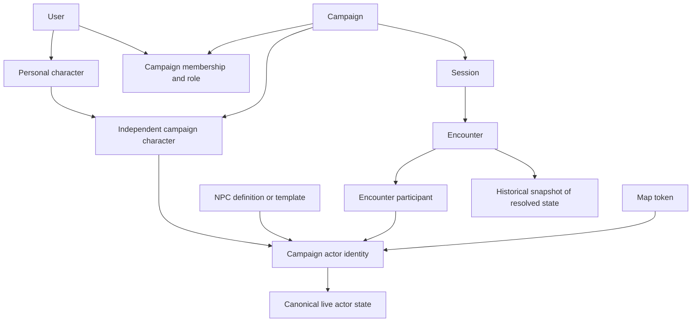

# Architecture: repository baseline and pilot design

Last inspected: 2026-11-19. No target application has been implemented.

## Actual repository

Before the knowledge-base task, the working tree contained a one-line `README.md` and the previously written `docs/PRODUCT_SPEC.md`. Only the README was in the initial remote commit. The knowledge-base task adds documentation and historical references, not an application.

```text
AGENTS.md
README.md
docs/
  PROJECT_CONTEXT.md
  ARCHITECTURE.md
  DECISIONS.md
  PROGRESS.md
  PRODUCT_SPEC.md
  TASKS.md
  references/
    README.md
    ORIGINAL_BRIEF_HE.md
    Adisdas_NPC_Codex.html
```

There are no package manifests/lockfiles, Angular workspace, application source directories, backend endpoints, migrations/schema, automated test suite, CI configuration, environment template, or deployment configuration. There is no valid target-app install/build/test command to run yet.

### Actual legacy reference architecture

[`references/Adisdas_NPC_Codex.html`](references/Adisdas_NPC_Codex.html) is a self-contained Hebrew RTL HTML file with inline CSS and vanilla JavaScript, not Angular source. Inspection found no external `src`/`href` resources. Its script parses the embedded `seed-data`, attempts to load browser storage, applies revisions, and renders one of three views: codex, players, combat.

- One mutable `state` object and UI state; event delegation and HTML string rendering.
- `localStorage` key `adisdas-npc-codex-v1`, `schemaVersion: 1`, `dataRevision: 4`.
- State arrays: locations, NPCs, players, encounters, saved encounters; plus current encounter ID.
- JSON backup export and whole-state replacement import with a basic structural check. The import handler limits the file to 5 MiB; this is legacy behavior, not the new product's decided limit.
- No server, account system, shared database, sessions, maps, real-time transport, PDF import, or dice roller.

| Legacy code anchor | Observed behavior / target implication |
| --- | --- |
| `applyDataRevision` | Revision-specific updates and player-HP normalization. Do not assume a fresh seed contains browser edits. |
| `validState` | Checks schema/array structure and some counts, not a complete domain validator. |
| `setPlayerHp`, `syncFighterHp` | Player sheet HP propagates to all encounter rows, even past encounters. Target needs canonical live state and immutable history. |
| `ensureEncounter`, `makeFighter` | New encounter automatically adds all players; NPC fighters get independent HP. Target requires selected participants and persistent world actor identities. |
| `turnEntries`, `next-turn` handler | Descending manual initiative, a shared entry per squad, round increment on wrap. Missing initiative sorts last. |
| `createSquad`, `disband-squad` handler | Template-derived independent fighters, shared initiative/target; disband leaves individual fighters. |
| `toggle-condition`, `toggle-dead` | Manual flags/tags. Death is not derived from zero HP. |
| `snapshot`, `load-snapshot` handler | Snapshot copies encounter; restoring creates another encounter and also changes canonical player HP. Viewing history in the target must never do this implicitly. |
| `exportJson`, file import handler | Entire legacy state backup/restore, not incremental bulk entity import. |

The reference can be opened as an HTML file for inspection. It writes browser-local state when run. This knowledge-base task inspected source and seed data; it did not perform browser UI testing or certify legacy behavior through execution.

## First pilot architecture

**Status:** implementation plan. No application code, environments, or cloud resources exist in the repository yet. Product behavior and acceptance IDs live in [PRODUCT_SPEC.md](PRODUCT_SPEC.md#תנאי-קבלה), with execution order in [TASKS.md](TASKS.md) and rationale in [DECISIONS.md](DECISIONS.md#first-pilot-decisions).

### Components and deployment

| Boundary | Selected baseline |
| --- | --- |
| Workspace | npm workspaces and one committed lockfile. Use Node.js 24 LTS (24.15.0 or later in the 24.x line) and npm 11. The latest stable Angular release at T01 is the web baseline. As of 2026-11-19 the current stable major is Angular 22, which requires TypeScript 6.0.x and supports the installed Node.js 24.15.0. Pin the compatible Angular and CLI versions and commit the lockfile in T01. Validate NestJS 11 and Prisma 7 with the chosen compiler. Keep package-specific TypeScript versions only if the server toolchain requires it and the shared contracts build cleanly. |
| Web | Angular standalone components, Router, responsive Hebrew RTL shell. Angular signals for feature state. Use Angular HTTP for commands and reads, authenticated fetch for server-sent events (SSE). Route guards guide navigation. The API enforces permissions. |
| Server | One NestJS modular monolith (Express adapter) under `/api/v1`, with modules for identity, campaigns/membership, personal characters/PDFs, play, and history. Serve the built Angular app at the same origin in staging. |
| Persistence | Supabase-managed PostgreSQL, Prisma Migrate as the only app-table migration tool with hand-written SQL in its migration files where needed for database constraints (A14), one private application schema. Use a restricted runtime role. Migrations use separate credentials. Keep the application schema unexposed to the browser/Data API. |
| Identity | Supabase Auth, Google OAuth with PKCE for the hosted pilot. The API checks issuer, audience, expiration and signature using the project's asymmetric signing keys. Map the verified subject to an internal user UUID. Campaign roles come from PostgreSQL. |
| Storage | Private Supabase Storage bucket for PDFs. The Nest API authorizes and streams uploads/downloads. Storage and database credentials stay on the server. |
| Environments | Local Supabase CLI stack via Docker, disposable CI stack with synthetic test accounts, separate hosted Supabase project and a single Render container for the hosted pilot. Use a direct DB connection where reachable or Supabase's session pooler when IPv4 is needed. |

```text
apps/web/             Angular routes, page components and feature state
apps/api/             NestJS modules and Prisma migrations
packages/contracts/    Request validation and inferred DTO types shared by web and API
docs/                 Product specification, architecture, decisions and tasks
```

Use Zod runtime schemas for requests at the API boundary and define read DTOs explicitly per audience. Keep domain rules in the module that owns the data. The web state represents the most recently confirmed server state and a separate pending/error state per command. It has a single projection of each visible actor. UI routes are `/campaigns`, `/c/:campaignId`, `/characters`, `/c/:campaignId/play`, and `/c/:campaignId/history/:sessionId`.

### First schema and invariants

| Table | Data and constraints |
| --- | --- |
| User | Internal ID and unique verified auth subject and display name. |
| Campaign | Owner, public name and description, `private/public` visibility, next session number. Creation also inserts the DM membership atomically. |
| Membership | Unique `(campaignId,userId)`; DM or player. All member-scoped reads and writes check the database role. |
| Character | Owner, required name, optional class, level, AC, Max HP and private notes. |
| CharacterPdf | Character/owner, opaque storage key, size and upload state. At most one attachment per character. The file is excluded from campaign copies. |
| JoinRequest | Campaign, requester, personal character ID and decision metadata. At most one pending request per campaign/requester via partial unique index. Allow a fresh request after cancellation or rejection. |
| CampaignCharacter | Campaign-specific character copy (A10). Campaign, membership, source character ID as provenance, and the shared character fields copied at approval time (name, class, level, AC, base Max HP). Unique per membership in the pilot. Holds base data only, never live HP. Private notes and the PDF are not copied. |
| CampaignActor | Campaign-scoped actor identity with a kind (`player_character` in the pilot; NPC kinds later). A player-character actor references exactly one `CampaignCharacter` (unique). Holds no character or NPC content fields, so later NPC actors reference their own definition/instance rows instead. |
| ActorState | One row per actor, live values only (A11). Effective Max HP (positive integer, the bound for HP commands), current HP (nullable, otherwise within 0..effective max), effects, monotonic version. At approval, effective Max HP is initialized from the copy's base Max HP and current HP is null. Changing effective Max HP is an explicit command governed by Q04, not a side effect of a base-data edit. |
| ActorEffect | Child rows of an actor: stable UUID, label, created by/at (A13). Removal targets the ID, so duplicate labels are safe. Changes bump the parent `ActorState` version in the same transaction. |
| Session | Campaign, unique number per campaign, active/ended, start/end time. Partial unique index on campaign where active. |
| ActivityEvent | Immutable per-action timeline entry with campaign, optional session (A12), actor where applicable, author, timestamp, authoritative before/after and stable ordering ID. Live-state commands always carry the session. Campaign-level actions such as join approval are recorded with a null session. Session history reads the entries for that session. |
| CommandReceipt | Unique `(userId, operationId)`; normalized command fingerprint and stored success outcome. Recheck scope before replay. The same ID with a different target or body yields a conflict. |

Enforce campaign-scoped foreign keys (including actor and session scope) where applicable. Allocate session number while holding the campaign row lock. Reuse that lock for approval and session lifecycle commands. Take locks in the order campaign → session → actor where applicable. Commands for live state lock the specific session row before the actor row, check that it remains active and matches the URL, and keep both checks within the committing transaction. End takes the same session lock. Approval, membership, campaign character copy, actor, initial state and the approval activity event are one commit. State changes and their event/receipt are also one commit. Concurrent duplicate receipts resolve by the unique constraint, rolling back the losing mutation and reading the committed receipt after checking access. Use short transactions without CDN, auth or storage calls inside them. Prisma Migrate is the only migration tool for application tables; do not also use Supabase CLI migrations for them (A14). Constraints the Prisma schema cannot express (partial unique indexes, `CHECK` bounds, campaign-scoped composite foreign keys, runtime-role grants) are hand-written SQL inside the Prisma migration files and are covered by integration tests. Provision the storage bucket separately.

### HTTP contracts

All campaign writes check role, scope and current state. Only public campaigns accept new join requests; publishing changes preserve existing members and pending requests. Re-read and validate the source at approval time, including ownership and positive Max HP. Use explicit projections for authenticated/public views. Every retriable campaign mutation accepts an `Idempotency-Key` UUID. Every mutable actor response includes a version. Timestamp fields use UTC/ISO 8601. Cursors on history are opaque and scoped to the requested session.

| Path under `/api/v1` | HTTP | Purpose |
| --- | --- | --- |
| `/me` | GET | Verified identity and app profile. |
| `/characters`, `/characters/:id` | GET, POST on collection; GET, PATCH on item | Owner library and manual fields. |
| `/characters/:id/pdf` | PUT, GET | Owner-only bounded PDF upload (retriable with an upload ID) and download. |
| `/campaigns`, `/campaigns/:id` | GET, POST on collection; GET, PATCH on item | My campaigns, creation, scoped/public detail and DM publication change. |
| `/campaigns/:id/join-requests` | GET, POST | DM list or caller's own requests; submit with personal character ID. |
| `/campaigns/:id/join-requests/:requestId/decisions` | POST | DM approve/reject or requester cancel; repeat approve returns the original membership and actor. |
| `/campaigns/:id/play` | GET | Authorized snapshot of session plus visible actors (available between sessions to members). |
| `/campaigns/:id/sessions` | GET, POST | Authorized history list or DM start. |
| `/campaigns/:id/sessions/:sessionId/end` | POST | DM ends that session. |
| `/campaigns/:id/sessions/:sessionId/actors/:actorId/commands` | POST | `damage(amount)`, `heal(amount)`, `setHp(value,expectedVersion)`, `addEffect(label)`, `removeEffect(effectId)`. |
| `/campaigns/:id/sessions/:sessionId/activity` | GET | Paginated authorized activity entries. |
| `/campaigns/:id/events` | GET (SSE) | Authorized play changes as invalidation signals. |

Responses for commands include the operation outcome and any version needed to reload state. Clients generate an ID once per user intent and reuse it only when the result is uncertain. After an uncertain result, a valid exact replay returns the saved result even if the original session has since ended, provided the caller still has access. A fresh command to that ended session is rejected. Clients refresh the snapshot after a replay rather than overwriting a newer version with the earlier result. Use `400` for invalid input shape, `401` for unavailable identity, `404` for inaccessible resources whose existence is private, `403` when the resource is visible but the action is forbidden, `409` for state/version or idempotency conflicts, `413` for upload size and `415` for unsupported file content. Return stable error codes and request IDs. Keep private fields out of errors.

### Synchronization and recovery

After committing, the instance notifies eligible SSE subscribers with a minimal `changed` event. Session lifecycle events go to current campaign members; actor events go to the DM and actor owner. Recheck current authorization before dispatch. Close expired streams and periodically recheck membership while connected. The browser uses a bearer header and reconnects with a fresh token on expiry. Tokens never go in stream URLs.

On initial connection and reconnection, connect to SSE then request the authorized play snapshot. If an invalidation arrives during a read, schedule a follow-up read. Coalesce requests and discard responses from old connection generations to avoid out-of-order display. After a commit the issuing client also refreshes. Heartbeats detect dead streams, and a 15-second reconciliation read while the play page is visible repairs a missed post-commit notification. The foreground page immediately reconnects/refreshes when brought back into view. Block new gameplay commands while disconnected or resynchronizing. On loss of authorization, stop the stream and clear the affected projection. Activity storage is independent of event delivery. One instance suffices for the pilot. Shared notification delivery is a prerequisite for scaling beyond one instance.

### PDF failure handling and operations

Set a 10 MiB limit at ingress and while reading the upload. Cap the number of stored PDFs per user in the pilot configuration, starting at ten. Check the PDF header and allowed type, assign an opaque storage key and download as an attachment with private/no-store cache headers. Keep the object private and available only after its metadata is ready. Reserve a pending record before writing the object. Reconcile or clean up failed/stuck uploads and prevent concurrent attempts from exceeding the one-file limit. Retry/reconcile by the same upload ID. A second distinct PDF for the same character is rejected during the pilot.

Use synthetic fixtures in local development, staging and CI. The tracked legacy HTML contains fictional DM-only story content and is reachable in the public repository. Exclude it from build output and container artifacts, and decide how to handle its GitHub exposure separately from application deployment.

Provide liveness and database readiness checks, structured redacted logs with request IDs, and app-level health metrics for errors, reconnects and command latency. Keep migrations reproducible and run them as a controlled deployment step before promoting compatible code. Record the database and object storage backup/restore path separately and rehearse recovery using synthetic data before a real campaign. Check hosted quotas, cost and cold starts at pilot release. Render's free compute is suitable for staging, with availability during game sessions evaluated separately.

### Release environments

`dev` is the integration branch and staging source. `main` is the production line, with releases deployed from an explicit version tag on a verified commit. Keep staging and production credentials, Supabase data and storage separate once production exists. See [branch and release workflow](TASKS.md#ענפים-וגרסאות).

### Angular maintenance

Review stable releases monthly and prioritize applicable security fixes. Update Angular framework packages and CLI together in a dedicated pull request. Use the [Angular Update Guide](https://angular.dev/update-guide) and [`ng update`](https://angular.dev/cli/update) to apply framework migrations. Advance one major at a time, checking Node.js, TypeScript and peer dependencies on each step. If a dependency blocks a stable update, record the blocker and stay on a supported release until the incompatibility is resolved. Merge after a clean install, build and the available CI tests pass. Once the pilot flow exists, include login, campaign access and two-client HP synchronization in the smoke check.

### References for tool selection

- [Angular version compatibility](https://angular.dev/reference/versions) · [Angular release support](https://angular.dev/reference/releases) · [NestJS prerequisites](https://docs.nestjs.com/first-steps) · [Prisma runtime requirements](https://www.prisma.io/docs/orm/v7/reference/system-requirements)
- [Supabase Google sign-in](https://supabase.com/docs/guides/auth/social-sign-in/auth-google) · [Supabase token verification](https://supabase.com/docs/guides/auth/jwts) · [Supabase private buckets](https://supabase.com/docs/guides/storage/buckets/fundamentals)
- [Supabase local CLI](https://supabase.com/docs/guides/local-development/cli/getting-started) · [Supabase Postgres connectivity](https://supabase.com/docs/guides/database/connecting-to-postgres) · [PostgreSQL partial indexes](https://www.postgresql.org/docs/current/indexes-partial.html) · [Render free compute limits](https://render.com/docs/free)

## Architecture beyond the pilot

### Feature boundaries

- Identity/access: accounts, ownership, membership, join requests, invitations, display access.
- Campaigns: profile, visibility, settings, roster.
- Characters: personal library, campaign copies, PDF attachment/manual entry.
- World: nested locations, named NPCs, reusable definitions, documents/assets.
- Sessions: lifecycle, numbering, notes, live-operation policy.
- Combat: participants, initiative, rounds, squads, history.
- Presentation/maps: map scenes, token placement, visibility and authorized player display.
- Data management: import preview/commit, migrations, backups, exports.

Suggested routes are rooted at `/campaigns/:campaignId/` for campaign-owned features, with separate personal-library and player-display routes. Final URLs are not selected. Later features can extend the feature-scoped Angular state established in the pilot. Cross-feature views reference shared canonical entities rather than synchronizing independent HP copies.

### Proposed data ownership



This is conceptual ownership, not an implemented schema or finalized cardinality diagram. The `CampaignActor` abstraction is proposed; named NPCs and campaign-character copies share the need for stable identity. A map token or encounter row references that identity instead of owning live HP. Some decorative tokens may have no actor. Snapshot data deliberately copies resolved values for history.

Other proposed entities: `Location(parentId)`, `Asset`, `Document`, `Map`, `Squad`, `PresentationState`, `ActivityEvent`, and `SessionNote`. Separate base/definition fields from live state and decide field ownership before writing migrations. An existing named NPC persists across encounters; spawning a reusable template creates separate identities.

### Session and history boundaries

The pilot supports active → ended and one active session per campaign. Later work may add planned and paused states, with explicit pause rules before implementation.

Encounter lifecycle and presentation selection are independent of the session lifecycle. DM selects encounter participants. Session/encounter start/end never implicitly resets actor HP, conditions, or resources. Historical viewing reads frozen state; any explicit restore needs its own authorization, preview, and current-state effects.

### Authorization boundaries

Campaign visibility, membership admission, and permission to individual fields/files are separate. Public discovery is not access to DM notes, full PDFs, hidden tokens, or the full player sheet. Re-check read and mutation access in HTTP handlers, file download delivery, subscriptions, and revocation of active connections. A player display must receive a filtered payload, not secrets hidden in the DOM.

The TV client needs narrow, revocable display authorization. Whether that uses pairing, a scoped token, or an authenticated display account is undecided. No local credential/SSH configuration is part of this design or repository.

### Imports and PDFs

The proposed bulk JSON envelope has `format`, `schemaVersion`, `sourceId`, and entity-specific arrays with `externalId`. Resolve identity within the destination campaign and source, never by name alone. Separate add-only and explicit update modes; missing fields preserve existing data, while explicit clearing semantics need a schema decision. Validate and map references, preview changes, then revalidate and save atomically. Detect state changes after preview. Full-backup restore is a different workflow.

Legacy import must preserve narrative strings, nulls, source IDs/mappings, and draft facts. A recent exported backup is preferable to embedded seed data when available. No importer is implemented.

PDF upload plus manual input is required. Extraction is proposed assistance only and must be reviewed by the user. No actual sample PDFs or extraction library have been selected; do not treat extraction as a solved capability.

## Validation plan once code exists

First prove one DM and one player can edit the same campaign character, see the changes on both clients, reconnect, and end/resume play without lost state. Include unauthorized/cross-campaign access, two simultaneous updates, repeated operation IDs, and unknown HP. Then extend to NPC instances, combat history, import replays, and TV projection while the DM switches views.

Document actual commands here when tooling is selected. The knowledge-base checkpoint only validates documentation, reference integrity, and repository state; it is not evidence of passing application tests.
